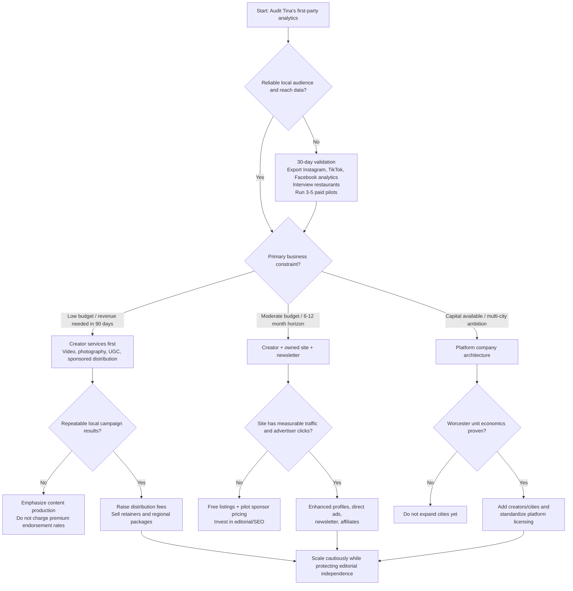

# Live to Eat Food: Monetization, Editorial Trust, Pricing, Website Strategy, and Regional Media Business Plan

## Executive Summary

This report evaluates the business opportunity described in the Live to Eat Food research brief: monetizing Dr. Tina Vo’s existing creator presence while building an independently owned Worcester/Central Massachusetts restaurant-discovery and food-media platform. fileciteturn0file0 The conclusion is favorable, but with an important qualification: **the strongest near-term business is not “getting restaurants to pay for reviews.” It is a creator-led local media and content-production business in which editorial recommendations remain independent, while restaurants buy clearly defined advertising, production, sponsorship, licensing, and distribution services.**

The public evidence supports Tina having a genuine local-market footprint. Her official Linktree identifies Instagram as `@livetoeatfood`, TikTok as `@livetoeatfoodie`, Facebook, an Amazon Storefront, and Yelp Elite participation. citeturn15search1 Search-indexed examples of her restaurant videos include roughly 6,700 views for a Racha Thai TikTok, 54,300 views for a Mochinut post, and 46,900 for a Worcester Public Market post; these are individual examples, **not an account-wide reach estimate**. citeturn15search2turn15search5 Independent restaurant-related pages also contain diners explicitly saying Live to Eat Food led or reminded them to try restaurants, which is anecdotal but useful evidence that the brand can influence local dining decisions. citeturn15search6turn15search13

What cannot be responsibly determined from public data is equally important: I could not verify Tina’s current follower counts, median impressions, audience geography, age distribution, Story reach, saves, shares, profile visits, link clicks, or conversion data. **Those figures should not appear in a media kit until Tina supplies first-party platform analytics.** The pricing strategy below therefore gives *experimental rate ranges*, not claims about what Tina is already worth.

The industry backdrop is favorable. IAB projected U.S. creator-advertising spending to reach approximately **$44 billion in 2026** after $37 billion in 2025; 48% of surveyed creator-ad buyers characterized creators as a “must buy.” More importantly for Tina, IAB found creator reputation and audience alignment among the most important creator-selection factors, which argues against valuing a highly local creator solely by follower count. citeturn20search1turn20search3 CreatorIQ’s September 2026 study reported that 48% of participating brands said they achieved at least 3x ROI from creator programs, although that is an industry-vendor survey and should not be translated into an assumed ROI for Worcester restaurants. citeturn20search2

**The initial revenue priorities should therefore be:**

| Priority | Business model | Why it should come first |
|---|---|---|
| Highest | Short-form restaurant content production and sponsored distribution | Can monetize Tina’s existing skills and audience without waiting for website traffic |
| Highest | Recurring restaurant/group content retainers | More predictable revenue than one-off posts; brands increasingly use repeat creator relationships citeturn20search0 |
| High | Photography/video licensing and UGC not posted as an endorsement | Monetizes production skill without consuming editorial trust |
| High | Direct website/newsletter sponsorships | Local advertiser economics can work at relatively low traffic if the audience is demonstrably local |
| Medium | Enhanced restaurant profiles and sponsored placements | Viable once traffic and click-through reporting exist |
| Medium | Events and sponsored dining guides | Potentially attractive but operationally heavier |
| Medium | Affiliates and digital guides | Useful diversification, but traffic-dependent |
| Low initially | Programmatic display advertising | Economically small until the site has meaningful pageview volume |
| Later | Paid membership | Requires demonstrated recurring reader value first |
| Later | Multi-city platform/SaaS functions | Scalable, but premature before Worcester unit economics are proven |

The key strategic insight is that **a local audience can be more commercially valuable to a Worcester restaurant than a larger but geographically diffuse audience**. A restaurant does not buy abstract followers; it buys the chance to reach people who can actually visit. IAB’s research reinforces that audience alignment and reputation matter in partner selection. citeturn20search3 Tina should therefore eventually report metrics such as “Central Massachusetts percentage,” median Worcester-area video reach, saves, shares, profile actions, reservation/click activity, and repeat exposure—not simply total followers.

The prototype has a promising product concept. The GitHub project describes itself as “a creator-led food discovery platform for Worcester and Central Massachusetts” and contains dedicated Discover, Explore, Guides, place, Tina, restaurant-owner, About, and brand-direction pages. fileciteturn2file0 The homepage concept includes intent filters such as craving, geography and dining companion; saved places; “Only places Tina has been”; embedded creator video; and restaurant/location discovery. It also currently contains a `noindex` directive and explicitly identifies itself as a concept sample, so it should **not** yet be treated as a production SEO property. fileciteturn3file0

The central business risk is trust. FTC rules, Meta/TikTok/YouTube disclosure requirements, Google Maps policies and Yelp rules all make it especially unwise to blur compensation and independent reviews. The FTC’s Endorsement Guides require clear and conspicuous disclosure of material connections, and the Consumer Reviews and Testimonials Rule prohibits practices including purchasing reviews conditioned on positive or negative sentiment. citeturn3search6turn3search0 Google Maps separately prohibits reviews incentivized with payments, discounts or free goods/services. citeturn14search14turn14search15 Yelp says advertisers receive no review-ranking preference and prohibits businesses from soliciting Yelp reviews. citeturn14search12

Accordingly, **restaurants may buy Tina’s time, production, advertising inventory, licensed assets and distribution—but they should never be sold a positive opinion, a guaranteed recommendation, an inflated rating or undisclosed favorable placement.**

A sensible first-year goal is not to maximize revenue at any cost. It is to prove three things:

1. Tina’s audience is sufficiently concentrated in the restaurant catchment area to create measurable value.
2. Restaurants will repeatedly pay approximately several hundred dollars to low four figures for well-defined services.
3. The owned website can turn Tina’s social attention into search traffic, email subscribers and advertiser value without damaging the editorial trust that created the audience in the first place.

The approach should branch based on what Tina’s first-party data shows:

## Current State and Market Position

**Observable Live to Eat Food footprint.** The strongest verified public source tying the channels together is Tina’s own Linktree. It identifies her as “Tina,” links Instagram `livetoeatfood`, TikTok `livetoeatfoodie`, Facebook Live to Eat Food, an Amazon Storefront and Yelp Elite, and says the Linktree account dates to February 2022. citeturn15search1 Another Worcester-area business-community page explicitly lists “Tina Vo — Live to Eat Food (& Tinaesthetics by Dr. Vo),” further corroborating the identity/business connection. citeturn15search10

Individual public posts suggest meaningful variability in content performance, which is normal for short-form video. Indexed examples include approximately 6.7K views/197 likes for Racha Thai, 54.3K/3.8K for Mochinut and 46.9K/3.7K for Worcester Public Market. citeturn15search2turn15search5 Those observations are useful for establishing that some content reaches well beyond a few hundred viewers, but they are **not sufficient to calculate Tina’s median reach or engagement rate**. A rate card based on the best-performing post would be misleading; a professional buyer should instead receive trailing medians and percentile ranges from first-party analytics.

Public evidence also supports real-world local recognition. A Kaffe.Inn customer review credits the Live to Eat Food blogger with putting the diner onto a menu item, while another Worcester restaurant page includes a customer thanking Live to Eat Food for prompting a return visit. These are not controlled attribution studies, but they are exactly the kind of anecdotal proof worth turning into formal campaign measurement. citeturn15search13turn15search6

**The missing data should become Tina’s first business audit.** Before publishing audience claims, export at least 90 days—preferably 12 months—of platform analytics and calculate trailing medians for Reel/TikTok views, Story impressions, Story completion, shares, saves, comments, profile visits, link clicks, follower geography, non-follower reach and audience demographics. For local commercial value, add the percentage of audience in Worcester/Central Massachusetts, Greater Boston and broader New England. Do not infer geography from comments or followers’ bios.

A useful media-kit dashboard would eventually say, for example:

> Median views across last 20 restaurant videos: **[actual]**  
> Median Story impressions: **[actual]**  
> Audience in Worcester/Central MA: **[actual]%**  
> Audience in Massachusetts: **[actual]%**  
> Median saves per restaurant Reel: **[actual]**  
> Average outbound restaurant actions: **[actual]**  
> Highest-performing content categories: **[actual]**

Until those cells are populated, leave them blank.

**Why regional concentration can matter more than headline follower count.** IAB reported that creator reputation and audience alignment were cited by 58% and 56% of surveyed buyers, respectively, among factors used in creator selection. citeturn20search3 For a Worcester restaurant, a creator with a smaller audience heavily concentrated within driving distance may therefore have more economic relevance than a national creator whose followers are largely outside Massachusetts. This does not automatically justify a premium; it just changes the appropriate denominator from “total followers” to **reachable prospective diners**.

A local restaurant's economics also argue for realistic pricing. The National Restaurant Association has described typical restaurant profit margins as only about 3–5%, and its 2026 reporting found significant operator profitability pressure. citeturn10search2turn10search13 That makes four-figure single-post packages difficult for many independents unless there is demonstrable reach, reusable content, measurable customer acquisition or a larger campaign objective.

There is, however, clear evidence that Worcester businesses already buy local media inventory. Worcester Regional Chamber advertising currently lists examples such as a website placement at $200 per month and newsletter placements around $200 per issue, with discounts for packages. citeturn10search1 That does not prove a restaurant will pay Tina the same amount, but it establishes a local-media comparison point: Tina is not asking businesses to adopt an entirely unfamiliar category of expenditure.

**Platform roles should be deliberately different rather than simple cross-posts.**

| Channel | Best commercial role for Live to Eat Food | Strength | Limitation |
|---|---|---|---|
| Instagram | Reels, Stories, restaurant storytelling, local sponsors | Visual identity, Story interaction, creator-brand tools | Algorithm/platform dependence |
| TikTok | Discovery-oriented restaurant videos | Potential for non-follower reach | Volatile per-post distribution |
| Facebook | Cross-posted video, local community reach, events | Strong local sharing/community utility | Do not assume same audience behavior as IG |
| YouTube | Shorts plus later evergreen restaurant/guide videos | Searchable, durable video library | More production effort for long form |
| Website | Search, structured restaurant profiles, guides, sponsor inventory | Owned asset and first-party data | Needs sustained content and traffic acquisition |
| Newsletter | Repeat dining recommendations and sponsor inventory | Direct subscriber relationship | Valuable only if list quality/open/click data are strong |
| Affiliate/commerce | Tours, products, experiences and later reservations | Adds performance-linked revenue | Needs traffic and careful disclosure |

The broader creator-advertising market supports a multi-channel strategy. CreatorIQ reported that its customers used an average of multiple platforms and that repeat partnerships represented a significant share of activity; its 2025 data showed 40% of creators were used across multiple campaigns. citeturn20search0

**Competitive and comparable models.** None is a perfect analog, which is useful: Live to Eat Food can borrow distinct pieces of several models rather than copying one.

| Comparable | Relevant model | Lesson for Live to Eat Food |
|---|---|---|
| BostonChefs.com | Regional culinary publication + restaurant membership/advertising/jobs/events | Demonstrates a focused local food audience can support B2B products; BostonChefs publicly reports 50,000 visitors and more than 500,000 pageviews monthly. citeturn13search0turn13search9 |
| FoodForKash | Boston/New England food creator | Regional creator precedent; BostonChefs documented a 20K+ following in 2021, though that figure is old. citeturn13search3 |
| KW Bites | Boston creator duo focused on restaurant discovery | Illustrates creator-led local restaurant discovery. citeturn13search5 |
| Christina Orso / Hungry Meets Healthy | Food creator who moved into restaurant marketing/consulting | Particularly relevant path from influencer activity to B2B restaurant services. citeturn13search12 |
| Taste of Massachusetts | New England food site + social + affiliate content | Close regional example of social, web, dining guides and affiliate links coexisting. citeturn22search0turn22search12 |
| Edible Worcester | Local food publication | Shows an existing Worcester editorial/advertising market and local appetite for dedicated food media. citeturn22search4 |
| Phantom Gourmet | Regional video, restaurant directory, events/gift-card ecosystem | Shows the power of recognizable regional food IP distributed beyond one social account. citeturn13search20 |
| The Infatuation Boston | Editorial restaurant recommendations + clearly labeled brand partnerships | Strong example of advertising coexisting with strong editorial voice; a 2026 Boston guide is explicitly labeled “In partnership with Chase Sapphire Reserve.” citeturn13search4 |
| Eater | Editorial maps/content + commerce integration | In 2026, Grubhub added ordering from select Eater discovery pages, demonstrating a path from editorial discovery to transaction. citeturn22search1turn22search10 |
| Beli | Social restaurant-discovery/ranking application | Demonstrates appetite for structured, social restaurant discovery and transaction integrations. citeturn22search1turn22news48 |
| Zest | Transaction-informed personalized restaurant discovery | Emerging competitive direction: using behavioral data rather than only generic rankings; TechCrunch reported a $1.8M pre-seed round, which is funding, not revenue. citeturn22search9 |

The differentiation opportunity is therefore **not** “another Yelp.” Google Maps and Yelp have overwhelming directory breadth; Eater and Boston Magazine have editorial resources; Beli and newer apps have product engineering. Tina’s defensible starting point is narrower: **a recognizable Central Massachusetts human curator + actual dining footage + structured place information + direct restaurant relationships + an explicit wall between sponsorship and recommendations.**

That combination also reduces the need to win on sheer database size. A thousand thin restaurant listings would probably be less useful than 100 carefully maintained profiles containing Tina’s actual visit, original video, dishes tried, occasion guidance, neighborhood context, parking/reservation information, update date and related local guides.

## Pricing, Packages, and Sales System

Published creator-rate benchmarks vary enormously, which is precisely why generic “$X per 10,000 followers” charts should not determine Tina’s pricing. Collabstr’s 2026 marketplace reporting placed average Instagram and short-form creator collaboration spending in the low hundreds of dollars, including about $288 for Reels and $217 for TikTok videos in its dataset; Later’s 2026 guidance places nano and micro creator deals across much wider ranges, from hundreds to low thousands depending on size, format and scope. citeturn9search3turn9search11 These are broad platform-marketplace benchmarks, not Worcester restaurant prices.

Usage rights materially alter economics. Collabstr’s 2025 report found collaborations with usage rights carried approximately a 40% higher average price in its marketplace, while Aspire’s creator research describes many creators pricing time-limited rights as an additional percentage of the base fee. citeturn8search9turn9search10 Accordingly, Tina should never casually give restaurants unlimited perpetual usage, raw footage, paid-ad rights and category exclusivity inside a basic social-post fee.

### Recommended pricing framework

Use:

**Expected local impressions**

\[
\text{Median impressions on comparable posts} \times \text{share of audience in target geography}
\]

Then:

\[
\text{Media value} =
\frac{\text{expected local impressions}}{1,000}
\times \text{negotiated target CPM}
\]

And the actual quote:

\[
\boxed{
\text{Quote} =
\max(\text{production floor},\text{media value})
+\text{hard costs}
+\text{usage rights}
+\text{exclusivity}
+\text{special complexity}
}
\]

The **production floor** is Tina’s expected shoot/edit/admin time multiplied by the internal hourly rate required to run a profitable business. The **target CPM is not a universal influencer-industry constant**; it should initially be negotiated from the advertiser’s local alternatives and subsequently replaced by Live to Eat Food’s own campaign history. This prevents a high follower count from subsidizing hours of unprofitable production and prevents a low follower count from understating proven local performance.

Engagement should be used diagnostically, not as a simplistic multiplier. Compare saves, shares, comments, clicks and profile actions against Tina’s *own* baseline for similar restaurant videos. A food video generating 30,000 passive views may be less valuable to a Worcester restaurant than a 10,000-view video that produces hundreds of local saves and measurable menu/directions clicks.

### Experimental rate card

The following are **recommended test prices, not observed Tina rates**. “Conservative” is appropriate before verified analytics and case studies; “market-aligned” assumes reliable local reach and several successful pilots; “premium” requires repeatable high local reach, conversion evidence, major production work, rights, scarcity or a larger hospitality buyer. The broad positioning is anchored against current creator marketplace guidance but adjusted for production and local-commercial value rather than follower count alone. citeturn9search3turn9search11

| Service | Conservative | Market-aligned | Premium |
|---|---:|---:|---:|
| Instagram Story, single frame | $75–$125 | $150–$250 | $300–$500 |
| Instagram Stories, 3-frame package | $150–$250 | $300–$450 | $600–$900 |
| Instagram Reel | $300–$450 | $500–$800 | $900–$1,500 |
| TikTok video | $250–$400 | $450–$750 | $800–$1,250 |
| Facebook photo/video post | $75–$150 | $150–$300 | $350–$600 |
| Reel/TikTok + Stories + Facebook campaign | $500–$750 | $850–$1,300 | $1,500–$2,500 |
| Restaurant content-production visit, no endorsement | $200–$350 | $400–$650 | $750–$1,200 |
| Sponsored editorial feature | $350–$600 | $700–$1,100 | $1,300–$2,200 |
| Five edited food photographs | $250–$400 | $450–$700 | $800–$1,200 |
| Website sponsored feature | $150–$300 | $350–$600 | $700–$1,000+ |
| Newsletter sponsor placement | $75–$150 | $150–$300 | $350–$600 |
| Event attendance/coverage | $200–$350 | $400–$750 | $800–$1,500 |
| Monthly restaurant retainer | $600–$900 | $1,200–$2,000 | $2,500–$4,000+ |

Website/newsletter prices in particular should not migrate to the higher columns merely because time passes. They should increase only when Tina can show impressions, unique users, open rates, clicks, geographic composition and sponsor outcomes.

**Costs should usually be separated.** If a restaurant commissions specific menu coverage, the required food should either be provided or reimbursed and should not be treated as Tina’s creative fee. A complimentary meal is an in-kind material connection when it is part of the creator relationship and must be disclosed when the resulting content is posted. citeturn3search6turn18search2 Parking, unusual travel and lodging should be pass-through expenses where relevant. Raw files, paid-ad usage, whitelisting/partnership-ad rights, extended licensing, exclusivity and substantial revisions should be separately priced. A normal organic review that Tina independently chooses should generally be self-funded.

A comped meal may also have tax implications when it is compensation for services. IRS guidance states that business income may be received in money, property or services and that the fair-market value of bartered goods/services is generally taxable; the precise treatment of hosted restaurant experiences should be reviewed with Tina’s accountant. citeturn16search1turn16search8

### Restaurant packages

**Independent Restaurant Pilot — $350–$550 experimental range.** One on-site shoot, one edited vertical video asset, five edited photographs and a basic performance report. At the lower end it is content-only; at the upper end it includes distribution on one Live to Eat Food channel. Food required for the brief is hosted/reimbursed. Usage is organic business social channels for 30 days; paid advertising is extra.

**Local Discovery Campaign — $750–$1,100.** One original Reel/TikTok-style video, cross-platform publication where appropriate, three Story frames, restaurant tags/CTA, a short website profile or sponsored feature once the site is live, five photographs and a 14-day results report. Sponsorship is disclosed on every applicable channel.

**Three-Month Restaurant Growth Partnership — approximately $1,250–$2,000 per month.** Two content visits or production sessions monthly, two vertical videos, a photo library, Story support, one website/newsletter promotional slot and reporting. It should be framed as marketing/content production—not a promise of positive reviews.

**Restaurant Group / Regional Hospitality Campaign — roughly $2,500–$5,000+ per month depending on scope.** Multiple locations, distinct creative concepts, batch production, broader distribution, analytics, asset licensing and possibly paid-media usage. Rights and exclusivity should be separately itemized because larger groups are more likely to reuse creative commercially.

For small independent restaurants, a $300–$750 experimental engagement is more likely to be sellable than immediately presenting a $2,500 package, given restaurants’ thin margins. citeturn10search2turn10search13 Larger groups, hotels, tourism businesses, restaurant developers, beverage brands and regional chains are more natural buyers for four-figure campaigns.

### Website advertising products

The local advertising benchmark matters here: Worcester Regional Chamber publicly lists a $200 monthly website ad and approximately $200 newsletter placements. citeturn10search1 Live to Eat Food cannot assume equivalent advertiser value before proving its own traffic, but those rates make the following pilot structure plausible:

| Product | Launch/pilot | After demonstrated performance |
|---|---:|---:|
| Standard restaurant listing | Free | Free |
| Verified/enhanced profile | $49–$75/mo | $99–$149/mo |
| Sponsored placement | $125–$200/mo | $250–$500/mo |
| Video-enabled enhanced profile | $200–$300 setup + listing | $300–$500 setup + recurring profile |
| Newsletter sponsor | $100–$150/send | $200–$500/send based on opens/clicks |
| Guide/category sponsor | $200–$350/mo | $500–$1,000+ with meaningful traffic |
| Annual local partner | $750–$1,250 pilot | $1,500–$3,500 after proof |

The free tier is important. Charging every restaurant to appear would convert the directory into an advertising catalog and undermine comprehensiveness.

Performance-based pilots can lower buyer risk: for example, a modest fixed production/placement fee plus a capped bonus for tracked reservations, redemption codes or qualified outbound actions. Do **not** offer payment for higher editorial ranking.

### Ready-to-use restaurant language

**Introductory outreach**

> Hi [Name] — I’m Tina from Live to Eat Food. I create restaurant and dining content focused on Worcester and Central Massachusetts. I’m opening a limited number of paid partnerships for restaurants that want original short-form video, photography and local distribution.  
>
> My paid partnerships are always clearly disclosed, and payment buys the agreed production and promotional deliverables—not a guaranteed positive review or rating. I’d be happy to send a simple package menu based on what you’re trying to accomplish.

**Hosted visit**

> Thanks for the invitation. I’m happy to consider a hosted visit. A complimentary meal does not purchase a positive opinion or guarantee organic coverage. If we agree in advance that I’m producing specific promotional content, I’ll outline the deliverables and disclose the hosted relationship clearly when it is published.

**Difference between review and sponsorship**

> Live to Eat Food keeps editorial recommendations separate from advertising. Independent reviews are chosen and evaluated by me. Sponsored content is a marketing service with defined deliverables and clear disclosure. Sponsors can verify factual details, but they cannot purchase a rating, ranking or favorable opinion.

**Rate-card introduction**

> My rates combine production work and, when included, access to the Live to Eat Food audience. Final pricing depends on the number of videos/photos, platforms, expected reach, travel, usage rights, exclusivity and whether the content will be used in paid advertising.

**Declining a demand for favorable coverage**

> I’d love to work together on content production or a clearly labeled promotional campaign, but I don’t sell guaranteed positive reviews, ratings or editorial rankings. That distinction is important to the audience and ultimately makes legitimate sponsored work more valuable.

### Media kit and sales workflow

A one-page media kit should contain **real analytics only**: Tina’s photograph/brand statement; geographic focus; current handles; actual platform audiences; trailing median reach rather than only peak posts; audience geography; top-performing content categories; representative restaurant work; package starting prices; testimonial/case-study evidence; and one sentence on editorial independence.

A sponsorship proposal should contain campaign objective, audience fit, deliverables, production schedule, disclosure language, usage rights, exclusivity, restaurant-provided expenses, total fee, payment schedule and reporting metrics.

A lightweight agreement should cover scope, deadlines, compensation, deposit, cancellation/kill fee, factual-review rights, Tina’s editorial/creative independence, FTC/platform disclosure, ownership, licensing period, paid-media rights, raw footage, exclusivity, confidentiality, restaurant trademark permissions, analytics reporting and dispute terms. A Massachusetts attorney should convert that outline into the actual form agreement.

Operationally, a practical default is a deposit at booking for new one-off clients, a short payment deadline on completion/publication, and monthly retainers billed in advance. Separate “editorial suggestion” and “commercial partnership” inquiry forms so a restaurant requesting consideration for coverage is not inadvertently entering a pay-for-review process.

The campaign report should show: deliverables completed, post URLs, views/impressions, unique reach where available, local geography where available, watch time, likes/comments/shares/saves, Story taps, profile actions, outbound clicks, tracked reservations/codes, asset usage rights and a short interpretation of what performed best.

## Legal, Ethical, and Editorial Rules

The foundational FTC principle is that a material relationship capable of affecting how consumers evaluate an endorsement should be clearly and conspicuously disclosed. The FTC’s 2023 Endorsement Guide update expressly warns that a platform’s built-in disclosure tool may not always be sufficient by itself. citeturn3search6 Its guidance also emphasizes proximity and visibility: disclosure should not be hidden in a profile, a general disclosure page or somewhere consumers are unlikely to notice. citeturn3search10turn3search12

The FTC’s Consumer Reviews and Testimonials Rule became effective October 21, 2024. Among other conduct, it prohibits fake/false reviews and buying reviews where compensation is conditioned on a particular positive or negative sentiment; it also addresses review suppression and certain undisclosed insider reviews. citeturn3search0turn3search5turn3search7

Massachusetts adds a state-law layer. Massachusetts General Laws Chapter 93A §2 prohibits unfair or deceptive acts or practices in trade or commerce and explicitly directs that FTC interpretations inform application of the statute. citeturn4search4 Massachusetts regulation 940 CMR 3.00 similarly governs unfair/deceptive consumer practices. citeturn4search3 An attorney should review the final sponsorship contract, advertising representations, contest/event terms and any dispute involving allegedly defamatory restaurant statements.

### Recommended editorial classification

| Type | Payment/benefit | Editorial control | Rating? | Required treatment |
|---|---|---|---|---|
| Organic visit | Tina pays normally | Tina | Yes, if desired | Independent editorial |
| Hosted visit | Free meal/experience | Tina | Prefer rating only in separately framed independent editorial | Prominent hosted/complimentary disclosure |
| Sponsored visit | Cash/in-kind for defined deliverables | Tina retains opinion; advertiser may fact-check | **No star rating inside sponsored asset** | “Paid partnership/Sponsored” disclosure |
| Paid promotional feature | Cash for advertisement | Collaborative ad creative | No | Clearly labeled advertising |
| Sponsored listing | Cash for placement/profile enhancement | Business controls factual listing info | No editorial score | “Sponsored” or “Featured advertiser” |
| Content-only production | Cash for photo/video assets; no Tina publication | Client approves commissioned asset | No implied endorsement | Contract must prohibit falsely implying Tina endorsed restaurant |

That final category is strategically valuable. A restaurant can buy Tina’s photography, video production and raw/edited assets without purchasing access to her public recommendation. This creates revenue that does not consume audience trust.

### Difficult cases

**What if Tina dislikes a sponsored restaurant?** The contract should state that compensation purchases Tina’s production time and agreed deliverables, not a positive endorsement. If the actual experience makes an honest recommendation impossible, the preferred remedies are: deliver usable neutral assets privately; reschedule once if the problem is clearly operational/correctable; publish only objective/promotional facts that Tina can honestly stand behind; or cancel public endorsement obligations under a pre-agreed kill-fee clause. She should not lie.

**Can a restaurant pay for a review without affecting its rating?** Legally distinct concepts can exist, but commercially it is a poor design. The cleaner policy is: a restaurant can sponsor *coverage*, but **not the rating**. If Tina later gives the restaurant an independent score, do it in a separate editorial context, disclose the prior/current material relationship and apply the same methodology used for non-sponsors.

**Does Tina have to post after taking a complimentary meal?** A mere invitation with no posting agreement should not create a publishing obligation. But where the meal is explicitly exchanged for content, the relationship is contractual and a material connection exists. Establish the terms **before** the meal.

**Can restaurants request approval?** For sponsorships, permit a limited factual check—restaurant spelling, addresses, menu names, prices, dates, allergy/ingredient facts, embargoes and trademark usage. Do not grant approval over Tina’s opinion, score or editorial conclusion. Paid ad copy itself can receive client approval because it is advertising, not independent review.

**Should sponsored content receive stars?** No. Avoid star ratings or “best” scores inside a paid promotional asset. A prominent “sponsored” label next to five stars creates precisely the ambiguity the editorial system should avoid.

**Can restaurants pay for higher search placement?** Yes, provided the placement is unmistakably advertising—e.g. “Sponsored”—and is separate from organic recommendation order. Compensated links should use `rel="sponsored"`; Google explicitly recommends that attribute for advertising and paid links. citeturn5search10turn5search12

**Can a category sponsor still be reviewed?** Yes, if the contract says sponsorship has no effect on editorial selection/ranking, and every relevant page discloses the relationship. For example, “Date Night Guides presented by X” can coexist with editorial picks, provided X did not buy inclusion or ranking.

**What if a restaurant demands removal of a negative review?** Correct material factual errors promptly and add updates where circumstances changed, but do not promise removal merely because an owner dislikes a truthful opinion. Maintain notes, receipts, dates and original footage. Escalate defamation threats to Massachusetts counsel rather than negotiating editorial changes for economic favors.

### Third-party review platforms are different from Live to Eat Food's own site

Google Maps’ current policies explicitly define incentivized reviews as ratings/reviews influenced by payment, discounts, free goods/services or other benefits and prohibit such contributions. citeturn14search14turn14search15 Accordingly, **a hosted or sponsored restaurant visit should not be converted into a Google Maps review.**

Yelp likewise draws a hard line around review integrity. Yelp says advertisers do not receive favorable treatment in its recommendation system and separately states that asking customers for Yelp reviews is not permitted. citeturn14search12 Tina’s Yelp activity should therefore remain outside her sponsored restaurant deliverables.

On **Live to Eat Food’s own media property**, Tina may publish clearly labeled sponsorships, advertisements and disclosed hosted experiences; the FTC focus is whether the advertising/material connection is misleading or inadequately disclosed. citeturn3search6turn3search0 This is a major reason to build an owned publication: Tina can create an explicit editorial/advertising architecture rather than trying to turn third-party consumer-review platforms into sponsorship channels.

### Platform-specific compliance

Meta’s official Instagram help says its Branded Content Policies require the **paid partnership label** when a creator’s content features or is influenced by a business partner in exchange for value, expressly including free/gifted products and affiliate links. citeturn18search2 Use that platform label **plus** plain-language disclosure in the content/caption.

TikTok’s official creator/business guidance requires creators promoting a brand/product/service in return for payment or another incentive to use its content disclosure setting; TikTok may restrict/remove improperly disclosed commercial content. citeturn6search0turn6search5

YouTube requires creators to declare paid product placements, sponsorships or endorsements in YouTube Studio; YouTube adds its paid-promotion disclosure, but creators remain responsible for applicable legal disclosure obligations. citeturn5search14

### Recommended disclosure language

**Paid restaurant partnership**

> **Paid partnership with [Restaurant].** I was paid to create and share this content. The restaurant did not purchase a rating or control my opinion.

**Complimentary meal**

> **Hosted by [Restaurant].** Our meal was complimentary. There was no payment for a positive review, and my comments are my own.

**Paid video**

> **Sponsored by [Restaurant].** This video is paid promotional content.

For video, make the relationship understandable in the video itself—spoken and/or clearly displayed—rather than relying only on a caption people may not open. That follows the FTC’s emphasis on clear, conspicuous disclosure close to the endorsement. citeturn3search6turn3search12

**Affiliate link**

> I may earn a commission if you purchase or book through this link, at no additional cost to you.

**Sponsored website listing**

> **Sponsored listing.** [Restaurant] paid for this placement. Sponsorship does not affect Live to Eat Food’s editorial recommendations or rankings.

**Product/meal supplied without editorial control**

> **Complimentary product/meal provided by [Restaurant].** No payment was made and the restaurant had no editorial control.

Do not rely exclusively on ambiguous shorthand such as `#sp`, a buried tag or “Thanks [Restaurant].” FTC staff has specifically cautioned against vague or hard-to-find disclosures. citeturn3search10

### Publishable editorial policy

> **Editorial Independence at Live to Eat Food**  
> Live to Eat Food accepts advertising, sponsorships, hosted experiences and paid content-production work. Commercial relationships are clearly labeled. Payment never guarantees a positive opinion, rating, recommendation or position in an editorial list.  
>
> Restaurants may review sponsored materials for factual accuracy, but advertisers do not control our independent editorial conclusions. Sponsored placements are visually identified and kept distinct from organic rankings.  
>
> When a restaurant provides a complimentary meal, product or experience, that relationship is disclosed whenever it is relevant to published coverage. Independent restaurant visits may be paid for by Live to Eat Food.  
>
> A sponsor may appear in an editorial guide only when it qualifies under the same editorial standards applied to non-sponsors. Sponsorship does not improve a restaurant’s rating or position.  
>
> We correct factual errors and update outdated restaurant information. We do not remove good-faith opinions merely because an advertiser or restaurant disagrees with them.

### Email, privacy and data

Commercial email is subject to CAN-SPAM. FTC guidance requires, among other things, truthful transmission/header information and subject lines, identification where required, a valid postal address and functioning opt-out mechanism; responsibility cannot simply be outsourced to an email vendor. citeturn16search0

Massachusetts’ 201 CMR 17.00 requires businesses holding covered “personal information” of Massachusetts residents to maintain safeguards including a written information-security program. Its statutory/regulatory definition is narrower than “any email address,” so Tina should not claim ordinary newsletter addresses automatically trigger every element of 201 CMR 17; however, once the business collects sensitive identifiers/payment information, Massachusetts security and breach obligations become much more significant. citeturn4search0turn4search18 As a practical matter, collect as little personal information as necessary, use reputable payment/email vendors, enable MFA, restrict staff access and publish a privacy policy describing analytics, email and advertising technologies. FTC data-security guidance likewise recommends inventorying and limiting sensitive information. citeturn16search14

## Website Monetization, SEO, and Competitive Strategy

The prototype is directionally stronger than a conventional food blog because it begins with a *decision problem*—“Where should we eat?”—rather than merely presenting a chronological article feed. Its current interface includes craving/location/companion selection, saved places, a “Only places Tina has been” filter, video integration, individual place concepts and guides. fileciteturn3file0 That architecture aligns well with the intended business: social video creates discovery; structured pages answer intent; guides aggregate recommendations; and sponsored inventory can sit beside, but not replace, editorial discovery.

The major immediate technical issue is that the prototype currently includes:

`<meta name="robots" content="noindex">`

That is appropriate for a concept site but must be removed when an approved production version is intended for organic search. fileciteturn3file0

### Revenue-stream attractiveness

| Revenue stream | Works with small local audience? | Traffic dependency | Trust risk | Potential |
|---|---|---|---|---|
| Content production/UGC | **Yes** | Very low | Low | High |
| Sponsored social campaigns | **Yes** | Existing social reach | Medium if overused | High |
| Direct restaurant sponsorship | **Yes** | Low–medium | Low if labeled | High |
| Enhanced profiles | Yes after traffic proof | Medium | Low | Medium–high recurring |
| Newsletter sponsors | Yes with engaged list | Medium | Low | Medium |
| Events | Yes | Community strength | Low | Medium–high |
| Premium guides | Somewhat | Audience trust | Low | Medium |
| Affiliate links | Somewhat | Medium–high | Low with disclosure | Medium |
| Programmatic display ads | Poor initially | **High** | Low–medium UX impact | Low early / higher at scale |
| Membership | Later | Loyalty | Medium | Medium if differentiated |
| Restaurant analytics/platform tools | Later | Data/merchant density | Low | High at regional scale |

**Programmatic advertising should not drive the launch plan.** Google’s current AdSense eligibility page requires original/high-quality content, policy compliance, site ownership/access and an adult account holder; its published eligibility page does not state a pageview threshold. citeturn17view3 That makes AdSense accessible relatively early, but accessibility is not the same thing as attractive economics.

Journey by Mediavine currently requires at least **1,000 Tier-1-country sessions in a 30-day period**, while full Mediavine now requires at least **$5,000 of annual ad revenue** plus content, traffic and brand-safety standards. citeturn19search5turn19search13 Mediavine says post-January-2026 “Official” publishers below $100,000 annual ad revenue receive a 75% publisher share. citeturn19search0

Raptive’s September 2026 eligibility guidance requires at least **25,000 monthly pageviews**, with additional traffic-country, domain-age and content requirements; its support materials state that publishers receive 75% of ad revenue. citeturn19search4turn19search11

For planning, not prediction, I would model local-food programmatic revenue using **$8 / $15 / $22 page RPM scenarios** rather than representing any one of them as a guaranteed market rate. Ad RPM varies too much by geography, season, device, advertiser demand, viewability and page design to give Tina a defensible universal number.

At 35,000 pageviews:

- $8 RPM = **$280/month**
- $15 RPM = **$525/month**
- $22 RPM = **$770/month**

That math explains why a $250 direct restaurant sponsor can be more important than another 10,000 pageviews during the early phase.

**Direct ads should therefore precede sophisticated programmatic optimization.** A small site with 8,000 highly relevant Central Massachusetts readers may be commercially useful to a restaurant despite being economically unimpressive to a national ad network.

### Affiliate opportunities

Viator’s official affiliate program currently advertises an **8% commission on completed bookings**, a 30-day cookie window and no minimum follower/traffic requirement. citeturn12search1turn12search3 This is more useful for New England food tours, cooking experiences and destination guides than for ordinary Worcester dinner reservations.

OpenTable currently has a U.S. **restaurant referral** program through December 31, 2026 under which an eligible restaurant referral that becomes a qualifying customer can produce a $500 gift card, subject to program limitations including a five-reward annual maximum. This is a restaurant-acquisition referral, not a standard diner-reservation affiliate commission. citeturn12search4

Tina’s own Linktree already exposes an Amazon Storefront, demonstrating an existing commerce path, but actual commissions should be modeled from her current Amazon Associates/Influencer account terms rather than guessed. citeturn15search1

The broader restaurant-discovery market is increasingly linking discovery directly to transactions. Grubhub’s June 2026 integrations let users order from restaurants discovered through Eater and Beli, illustrating where an independent food-discovery platform can ultimately create commerce value even though I found no public general-purpose Grubhub publisher commission schedule suitable to model for Tina today. citeturn22search1turn22search10

### Premium products, membership and events

Premium guides are better early experiments than a full membership: “Worcester Date Night Map,” “Best Food Along Shrewsbury Street,” “Central Mass Weekend Food Trail,” “Where to Eat Before a Hanover Theatre Show,” “New Worcester Restaurants,” holiday gift guides and weekend itineraries can be sold inexpensively or used as email-acquisition products.

Membership should come later, once reader interviews show a recurring problem worth paying to solve. Simply putting free restaurant recommendations behind a paywall would probably weaken growth. More defensible member value would include constantly updated maps, personalized lists, early event access, member-only dining itineraries and community experiences.

Restaurant-discount programs are riskier. With restaurant margins commonly in the low single digits, permanent 10–20% discounts can destroy the very merchant economics the platform needs. citeturn10search2 Benefits such as early reservation windows, small complimentary add-ons, event access or occasional sponsored perks may be more sustainable than blanket percentage discounts.

Events can become meaningful once Tina proves attendance demand. Worcester already sustains restaurant-centric events such as Worcester Restaurant Week and Taste of Shrewsbury Street; the 2026 Taste of Shrewsbury Street charged $25 in advance/$30 on the day for participating restaurant samples. citeturn22search8turn22search18 That supports testing small curated tasting walks, creator dinners or chef collaborations, but insurance, alcohol licensing, venue contracts, refunds and attendee safety warrant legal/insurance review.

### SEO and AI-search strategy

Google’s reviews system explicitly covers recommendations about services and businesses such as restaurants and says it seeks insightful analysis and original research rather than thin summaries. citeturn21search7 That fits Tina unusually well: her defensible SEO asset is **first-hand experience**.

The first-year editorial program should therefore center on:

**Restaurant profiles:** original photographs/video, Tina’s visit date, what she actually tried, who the restaurant suits, dishes worth ordering, neighborhood/location context, reservation/parking information, price context and update history.

**Intent guides:** “Best date-night restaurants in Worcester,” “Where to eat near Polar Park,” “Best Worcester Vietnamese food,” “Shrewsbury Street restaurants,” “Central Mass brunch,” “restaurants for large groups,” “late-night Worcester food,” and seasonal/new-opening guides—only where Tina has sufficient first-hand evidence to make the page genuinely useful.

**Video-to-page conversion:** every strong Reel/TikTok should have a permanent site destination with structured restaurant information, related guides and an email/save action. Social becomes acquisition; the website becomes the archive.

**Technical markup:** use the appropriate Restaurant/LocalBusiness, Article, BreadcrumbList and VideoObject structured data where accurate. Review markup should be implemented only where Google’s requirements are met. Google does not display self-serving LocalBusiness review rich results when the reviewed business controls those reviews. citeturn21search10

**Sponsored links:** use `rel="sponsored"` for compensated links. citeturn5search10turn5search12

**AI search:** Google’s May 2026 Search guidance says optimizing for its generative-AI Search features remains grounded in conventional SEO fundamentals and emphasizes valuable, unique, non-commodity content plus local, image and video information. citeturn21search4turn21search6 There is therefore no need to create hundreds of “AI-optimized” pages. Tina’s strongest answer-engine strategy is the same as her strongest human strategy: specific, original, well-structured local knowledge.

Avoid scaled, thin pages. Google’s spam policies classify large-scale low-value content created primarily to manipulate rankings as scaled-content abuse, regardless of whether it was produced by people or automation. citeturn21search3 Google also continues enforcing site-reputation-abuse policy against third-party content used to exploit a host site’s ranking signals. citeturn21search0turn21search1 Sponsored restaurant pages therefore need genuine first-party editorial/product involvement and reader usefulness rather than becoming SEO landing pages written by advertisers.

A sensible traffic plan is:

| Period | Content/technical objective | Distribution objective |
|---|---|---|
| First 30 days | Production domain, remove `noindex`, analytics/Search Console, sitemap, privacy/disclosure pages, 15–25 strong place pages | Link every relevant social video to owned destination where practical |
| Months 2–3 | 30–50 curated restaurant pages + 6–10 high-intent Worcester guides | Newsletter launch; lead magnet/map |
| Months 4–6 | Update winners, build neighborhood/cuisine clusters, add original video and internal links | Local backlinks/PR and restaurant attribution |
| Months 7–12 | Expand only into nearby markets supported by Tina’s actual dining/content footprint | Newsletter growth, collaborations and selective paid acquisition tests |

Do not expand to Boston, Providence or all of New England merely because the CMS can generate pages. Expand geographically only after Worcester pages attract search/social users and at least a small base of paying advertisers.

## Financial Model, Partnership Options, and Twelve-Month Roadmap

The figures below are **illustrative planning cases, not Tina’s current or guaranteed earnings**. They exclude income taxes and are intended to expose what has to be true operationally for the business to work.

### Existing social-media business

| Monthly assumption | Conservative | Base case | Optimistic |
|---|---:|---:|---:|
| Sponsored campaigns | 2 × $350 = $700 | 4 × $600 = $2,400 | 6 × $900 = $5,400 |
| Content-only/photo work | 1 × $300 = $300 | 2 × $400 = $800 | 3 × $550 = $1,650 |
| Events/appearances | $125 avg. | $400 | $1,200 |
| Retainers | $0 | 1 × $900 | 2 × $1,500 |
| **Monthly revenue** | **$1,125** | **$4,500** | **$11,250** |
| Estimated cash operating costs | $425 | $1,300 | $3,200 |
| **Monthly contribution** | **$700** | **$3,200** | **$8,050** |
| **Annualized revenue** | **$13,500** | **$54,000** | **$135,000** |
| **Annualized contribution** | **$8,400** | **$38,400** | **$96,600** |

The base-case gross margin before general overhead is approximately 80% if direct production/travel/subcontracting cost is about $900 on $4,500 revenue. The $3,200 figure above is an operating contribution after another roughly $400 of software/admin overhead; it is **not owner salary**.

That distinction matters. If Tina wanted the business to support $4,000/month of owner compensation plus $400 fixed overhead at an 80% pre-overhead margin, approximate break-even revenue would be:

\[
(4,000 + 400) / 0.80 = \$5,500/month
\]

So a $4,500 revenue month can be a healthy side business without necessarily being a full economic replacement for professional income.

### Creator plus local website

The base case assumes 35,000 monthly pageviews, 12 enhanced advertiser profiles at $125, three direct sponsor placements at $250, two newsletter placements at $200, $525 of modeled display advertising at a $15 RPM, $300 of affiliate/digital revenue and $3,200 of creator/B2B services.

| Monthly assumption | Conservative | Base | Optimistic |
|---|---:|---:|---:|
| Pageviews | 8,000 | 35,000 | 100,000 |
| Modeled display RPM | $8 | $15 | $22 |
| Display ads | $64 | $525 | $2,200 |
| Enhanced profiles | $375 | $1,500 | $4,375 |
| Direct sponsored inventory | $150 | $750 | $2,100 |
| Newsletter | $100 | $400 | $1,200 |
| Affiliate/digital products | $75 | $300 | $1,000 |
| Social/B2B services | $1,500 | $3,200 | $6,000 |
| Events/other | $0 | $0 | $1,200 |
| **Monthly revenue** | **$2,264** | **$6,675** | **$18,075** |
| Cash operating expenses | $1,100 | $2,500 | $6,500 |
| **Monthly contribution** | **$1,164** | **$4,175** | **$11,575** |
| **Annualized revenue** | **$27,168** | **$80,100** | **$216,900** |
| **Annualized contribution** | **$13,968** | **$50,100** | **$138,900** |

These are mature monthly run rates, not what a brand-new site should expect from January through December. A launch-year model should apply a substantial ramp discount because search traffic, newsletter subscribers and advertisers accumulate over time.

The economics show why direct sales matter. In the base case:

- Five additional $125 profiles add **$625/month**.
- Two additional $250 direct sponsors add **$500/month**.
- One additional $600 social campaign adds **$600/month**.
- Another 10,000 pageviews at $15 RPM adds only **$150/month**.

That is the central early-stage website insight: **selling a useful local advertising product is economically more important than squeezing another few dollars of programmatic RPM from a small site.**

At an illustrative 77.5% gross margin and roughly $1,000 monthly fixed overhead, the base website/creator model would require about $1,290/month to cover fixed overhead before paying Tina. Add a $4,000 monthly owner-compensation target and approximate cash break-even rises to roughly:

\[
(1,000 + 4,000)/0.775 \approx \$6,450/month
\]

The modeled $6,675 base case therefore just clears that more meaningful threshold, which is a healthier way to think about “break-even.”

### Regional food-media platform

Scaling creates revenue but also introduces real payroll, sales, editorial and technology costs.

| Assumption | Conservative regional | Base regional | Optimistic regional |
|---|---:|---:|---:|
| Monthly pageviews | 120,000 | 350,000 | 800,000 |
| Display RPM assumption | $12 | $18 | $24 |
| Paying local/regional advertisers | 20 | 50 | 90 |
| Avg. recurring advertiser fee | $200 | $300 | $450 |
| Sponsored campaigns/month | 3 | 6 | 10 |
| Other newsletter/affiliate/events | ~$1,500 | ~$5,500 | ~$13,200 |
| **Monthly revenue** | **$9,190** | **$32,800** | **$86,900** |
| **Monthly operating cost** | **$7,000** | **$24,000** | **$66,000** |
| **Annual revenue** | **$110,280** | **$393,600** | **$1,042,800** |
| **Annual operating contribution** | **$26,280** | **$105,600** | **$250,800** |
| Contribution margin | 23.8% | 26.8% | 24.1% |

The regional numbers expose another weak assumption worth challenging: **scale is not automatically more profitable.** Salespeople, city editors/creators, travel, insurance, customer support, technology and management all rise with expansion. A $1 million media business can be considerably harder to operate than a $100,000 creator business.

### Technology and business partnership structures

The guiding principle should be to distinguish **Tina’s pre-existing creator assets** from **new platform assets**.

Tina’s pre-existing social accounts, personal likeness, Live to Eat Food mark/brand if already hers, legacy content and pre-existing restaurant relationships should not automatically become jointly owned merely because a developer builds a website. Conversely, a technology partner should not be expected to make an indefinite material engineering contribution without clear compensation, ownership or revenue economics.

| Structure | Example economics | Advantages | Main risk |
|---|---|---|---|
| Development fee | Tina pays negotiated build + maintenance; retains business/site ownership | Cleanest ownership | Upfront cash requirement |
| Reduced fee + limited revenue share | Reduced development fee + e.g. 10–15% of defined *platform revenue* for 24–36 months, possibly capped | Aligns launch incentives without permanent equity | Must define revenue narrowly |
| Joint venture | New LLC; equity vests against ongoing contributions | Supports true long-term partnership | Deadlock/valuation/IP risk |
| Separate platform company | Tina licenses brand/content; tech entity or JV owns platform IP | Easier to scale/white-label | More legal/accounting complexity |
| White-label platform | Core software remains platform company IP; Tina gets creator-specific license; other creators license same technology | Highest software scalability | Can dilute exclusivity if poorly structured |

Those percentages are negotiating illustrations, not claims about fair market equity.

A permanent 50/50 company merely because one party built version one of the website is usually hard to justify unless the parties are also making comparably valuable **ongoing** contributions. Conversely, asking the technical partner to indefinitely maintain/productize a multi-city software platform for a one-time discounted fee may also be economically unfair.

A robust agreement should explicitly allocate:

**Brand and accounts.** Who owns “Live to Eat Food,” domains, Instagram/TikTok/Facebook accounts, likeness and goodwill?

**Content.** Tina should normally retain ownership of her original creator content while granting the platform the licenses it actually needs. Restaurant-supplied assets should have documented permission.

**Software/IP.** Identify pre-existing developer code separately from code created specifically for the venture. Define source-code access, licenses and what happens after termination.

**Customer data.** Define who owns advertiser CRM records, subscriber lists, restaurant profiles and analytics. A jointly operated company generally needs company-level rights to operate after personnel change.

**Money.** Define “gross revenue,” “net revenue,” pass-through ad spend, refunds, affiliate income, social deals unrelated to the platform, taxes and reimbursed restaurant costs. A developer should not receive a percentage of Tina’s unrelated influencer revenue unless that was intentionally bargained for.

**Governance.** Spending authority, hiring, advertising policy, editorial authority, product authority, bank access and decisions requiring unanimous approval.

**Departure/buyout.** Valuation formula, right of first refusal, vesting, bad-leaver/good-leaver concepts where appropriate, content/license continuation, customer migration, domain control and transition assistance.

**Editorial veto.** Tina or an editorial function should retain final authority over whether a restaurant receives an organic recommendation. A technology investor should not be able to sell editorial rankings.

Massachusetts business counsel and a CPA should review the entity, intellectual-property, revenue-share, sales-tax/income-tax and compensation implications before equity is issued.

### Twelve-month implementation roadmap

| Period | Build | Sell | Measure | Do not do yet |
|---|---|---|---|---|
| First 30 days | Analytics audit; disclosure/editorial policy; standard contract; simple rate card; production-site requirements | Interview 10–15 restaurants; sell 3–5 pilot campaigns | Actual local audience share, median reach, production hours, willingness to pay | Membership, app, multi-city rollout |
| Days 31–90 | Launch production website core; 20–40 high-quality restaurant profiles; newsletter; campaign dashboard | Convert pilots into 1–3 retainers; introduce $49–$75 enhanced-profile pilots | Cost per deliverable, repeat purchase, outbound clicks, sponsor satisfaction | Heavy programmatic ads |
| Months 4–6 | 50–100 quality place pages; guide clusters; SEO updates; sponsor labeling system | Direct site/newsletter sponsors; case-study-driven rate increases | Search traffic, email acquisition, churn, advertiser renewal | Hundreds of thin listings |
| Months 7–12 | Improve personalization/saved places; nearby-market tests; event infrastructure | Annual partners, selective events, affiliate/digital products | LTV, sponsor renewal, event margins, search-to-restaurant actions | Broad New England expansion without Worcester profitability |

The milestones should be commercial rather than vanity-based. “Reach 50,000 Instagram followers” is less useful than “60% of pilot sponsors say they would buy again at the same or higher price” or “direct restaurant advertising covers monthly website operating costs.”

Initiatives I would explicitly **delay or reject** include pay-for-five-star-review packages, undisclosed comped visits, paid organic rankings, unlimited usage rights bundled free into posts, expensive custom mobile apps before product-market fit, large discount clubs before restaurant economics are understood, mass AI-generated restaurant pages and geographic expansion before Worcester generates repeat advertisers.

## Sources and Research Notes

The research deliberately gives more weight to primary regulators, official platform documentation, first-party ad-network/program documentation and original industry surveys. Marketplace creator-rate reports are used as benchmarks rather than truth because creator pricing remains highly heterogeneous.

**FTC — Endorsement Guides update, June 29, 2023.** Material connections and clear/conspicuous disclosures. citeturn3search6  
`https://www.ftc.gov/news-events/news/press-releases/2023/06/federal-trade-commission-announces-updated-advertising-guides-combat-deceptive-reviews-endorsements`

**FTC — Consumer Reviews and Testimonials Rule Q&A, current resource accessed October 11, 2026.** citeturn3search0  
`https://www.ftc.gov/business-guidance/resources/consumer-reviews-testimonials-rule-questions-answers`

**FTC — CAN-SPAM Compliance Guide, August 2023; page notes January 2024 penalty update.** citeturn16search0  
`https://search.ftc.gov/business-guidance/resources/can-spam-act-compliance-guide-business`

**Massachusetts General Laws Chapter 93A §2, accessed October 11, 2026.** citeturn4search4  
`https://malegislature.gov/Laws/GeneralLaws/PartI/TitleXV/Chapter93A/Section2`

**Massachusetts 940 CMR 3.00, accessed October 11, 2026.** citeturn4search3  
`https://www.mass.gov/regulations/940-CMR-300-general-regulation`

**Massachusetts 201 CMR 17.00, accessed October 11, 2026.** citeturn4search0  
`https://www.mass.gov/regulations/201-CMR-1700-standards-for-the-protection-of-personal-information-of-ma-residents`

**Instagram Help — “What is considered branded content,” accessed October 11, 2026.** Meta states paid-partnership labeling applies to compensation, gifted/free products/services and affiliate content. citeturn18search2  
`https://www.facebook.com/help/instagram/616901995832907`

**TikTok Help — promoting a brand, product or service, accessed October 11, 2026.** citeturn6search0turn6search5  
`https://support.tiktok.com/en/business-and-creator/creator-and-business-accounts/promoting-a-brand-product-or-service`

**YouTube Help — paid product placements, sponsorships and endorsements, accessed October 11, 2026.** citeturn5search14  
`https://support.google.com/youtube/answer/154235`

**Google Maps User-Contributed Content Policy — incentivized/biased reviews, accessed October 11, 2026.** citeturn14search14  
`https://support.google.com/contributionpolicy/answer/16597558?hl=en`

**Yelp Support — advertiser/review recommendation independence, accessed October 11, 2026.** citeturn14search12  
`https://www.yelp-support.com/article/Do-businesses-that-advertise-on-Yelp-get-special-treatment-by-the-recommendation-software?l=en_US`

**Google Search Central — sponsored/nofollow link treatment, September 10, 2019; still reflected in current guidance.** citeturn5search10  
`https://developers.google.com/search/blog/2019/09/evolving-nofollow-new-ways-to-identify`

**Google Search — reviews system, accessed October 11, 2026.** citeturn21search7  
`https://developers.google.com/search/docs/appearance/reviews-system`

**Google Search — generative-AI optimization guidance announcement, May 15, 2026.** citeturn21search4  
`https://developers.google.com/search/blog/2026/05/a-new-resource-for-optimizing`

**Google Search — site-reputation policy update, August 28, 2026.** citeturn21search0  
`https://developers.google.com/search/blog/2026/08/update-site-reputation-policy`

**Google AdSense — eligibility requirements, accessed October 11, 2026.** citeturn17view3  
`https://support.google.com/adsense/answer/9724?hl=en`

**Mediavine — current 2026 application requirements, accessed October 11, 2026.** citeturn19search5  
`https://www.mediavine.com/application-requirements/`

**Mediavine — current revenue share, accessed October 11, 2026.** citeturn19search0  
`https://help.mediavine.com/revenue-share`

**Raptive — eligibility, updated September 26, 2026.** citeturn19search4  
`https://help.raptive.com/hc/en-us/articles/360032840891-Who-is-eligible-for-Raptive`

**Viator Partner Resources, accessed October 11, 2026.** citeturn12search1turn12search3  
`https://partnerresources.viator.com/`

**OpenTable U.S. restaurant-referral program, accessed October 11, 2026; offer described as running through December 31, 2026.** citeturn12search4  
`https://www.opentable.com/restaurant-solutions/referral/customer/`

**IAB — 2025 Creator Economy Ad Spend & Strategy Report, November 20, 2025.** Includes the $44 billion 2026 projection. citeturn20search1  
`https://www.iab.com/insights/2025-creator-economy-ad-spend-strategy-report/`

**CreatorIQ — State of Creator Marketing study release, September 30, 2026.** Survey of more than 2,000 global brand/agency respondents. citeturn20search2  
`https://www.creatoriq.com/press/releases/seventh-annual-creatoriq-study-finds-creator-marketing-delivers-record-roi-amid-infrastructure-and-ai-complexities`

**Worcester Regional Chamber — current advertising rates, accessed October 11, 2026.** citeturn10search1  
`https://www.worcesterchamber.org/advertising/`

**BostonChefs — business model and traffic claims, accessed October 11, 2026.** citeturn13search0  
`https://www.bostonchefs.com/about/`

**Live to Eat Food official Linktree, accessed October 11, 2026.** citeturn15search1  
`https://linktr.ee/livetoeatfood`

**Live to Eat Food prototype repository, inspected October 11, 2026.** The repo contains the current concept’s home, discovery, guides, place, creator and restaurant-owner pages. fileciteturn2file0  
`https://github.com/CptNope/Live-to-Eat-Food`

Important limitations remain. Public social indexing is inadequate for a professional valuation of Tina’s account. Restaurant conversion attribution is currently anecdotal. Published influencer marketplace rates blend geographies, verticals, creator sizes and campaign rights. Programmatic RPMs are inherently volatile. The financial cases above therefore use transparent modeling assumptions rather than pretending to be observed Live to Eat Food results.

The next analytic dataset should be Tina’s own exports: 12 months of platform insights, past paid/hosted collaborations, production time, advertiser inquiries, website analytics once deployed and any historical evidence that diners visited a restaurant after seeing her content. Those inputs would allow the recommended rate ranges to be replaced with statistically grounded Live to Eat Food pricing.

## What I Would Implement First for Live to Eat Food

I would **not** begin by trying to turn the prototype into a large Yelp competitor, and I would **not** lead sales conversations with “pay Tina for a review.”

I would launch Live to Eat Food as a **three-layer creator-led local media business**.

**The first layer is independent editorial.** Tina continues visiting restaurants she genuinely wants to explore, paying for a meaningful portion of independent review meals, publishing what she actually thinks and maintaining best-of guides that restaurants cannot buy their way into. This is the trust engine. Without it, every other revenue stream becomes progressively less valuable.

**The second layer is a clearly separated commercial studio.** Restaurants can buy vertical video production, food photography, Story/Reel/TikTok distribution, event coverage, licensing and recurring content packages. The offer should say plainly: **“You are paying for professional content, Tina’s time and the agreed distribution—not a guaranteed positive opinion.”** Start with three to five Worcester pilot advertisers at approximately $350–$750 depending on deliverables, measure everything and turn the best results into case studies. Larger regional groups can then be sold higher-value packages.

**The third layer is the owned discovery product.** Convert the current prototype into a production site on an owned domain, remove `noindex`, install analytics/Search Console, launch with a curated—not exhaustive—set of places Tina has actually visited and add strong Worcester intent guides. The existing concept already points in the right direction with dining-intent filters, saved places, creator videos, guides and restaurant profiles. fileciteturn3file0 The website’s purpose in year one is less “earn display-ad money” and more **convert ephemeral social attention into searchable pages, newsletter subscribers, advertiser inventory and first-party behavioral data.**

I would establish five non-negotiable rules from day one:

**No paid positive ratings. No undisclosed comped meals. No sponsored restaurants secretly boosted in editorial rankings. No perpetual commercial content rights hidden inside a normal post fee. No third-party Google/Yelp sponsored-review deliverables.** FTC, Google, Yelp and platform policies make those boundaries both legally prudent and strategically sound. citeturn3search6turn3search0turn14search14turn14search12

During the **first 30 days**, I would obtain Tina’s first-party social analytics, calculate trailing median performance, interview at least ten restaurant owners/managers about actual marketing pain points, finalize the editorial policy and sponsorship contract, and run three to five paid pilots. The first objective is not maximum rate—it is discovering what restaurants will renew.

By **day 90**, I would want a media kit containing verified local audience data, at least two campaign case studies, one recurring advertiser, a working newsletter, a production website with several dozen strong Worcester restaurant pages and a clean distinction among “Tina recommends,” “Hosted,” and “Sponsored.”

During **months four through six**, I would introduce direct sponsored website placements and enhanced profiles at low pilot rates, expand search-oriented guides, and target restaurant groups/hospitality businesses for retainers. I would treat programmatic ads as supplementary because the base-case economics show that a handful of $125–$250 local advertisers can matter more than tens of thousands of incremental pageviews.

During **months seven through twelve**, I would test one or two carefully produced ticketed events, a premium/digital guide, selected affiliate links and a nearby geographic expansion where Tina already has genuine dining credibility. Membership would be tested only if audience research shows a recurring value proposition people will actually pay for.

For the technology partnership, my default preference would be **Tina retaining her creator brand, social accounts and legacy content while either paying for development or using a limited, clearly defined platform-revenue share in exchange for reduced development cost.** I would move to shared company equity only if the technology partner is truly committing long-term product work, infrastructure and business-building effort comparable to Tina’s continuing brand/content/sales contribution. The agreement should be executed before significant customer or subscriber data accumulates.

The ultimate positioning should be simple:

> **Live to Eat Food helps Central Massachusetts decide where to eat through Tina’s real dining experiences, original video and useful local guides. Restaurants can advertise with us, but they cannot buy Tina’s opinion.**

That distinction is not a constraint on monetization. It is the asset that makes the monetization defensible. In a market where creator spending is growing but brands increasingly care about credibility, audience fit and measurable ROI, Live to Eat Food has a stronger long-term opportunity as a **trusted local media property with a creator at its center** than as either a conventional influencer account or a pay-to-play restaurant directory. citeturn20search1turn20search2